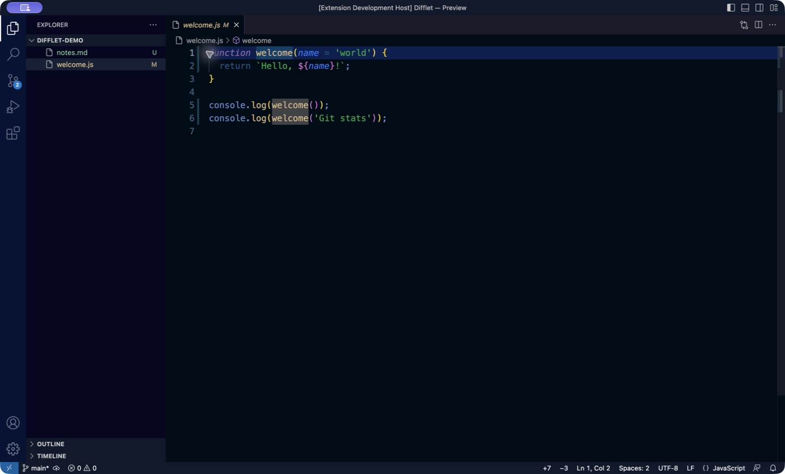

## The short version

Difflet is a small VS Code extension that shows how many lines you've added and removed in your Git working tree, right in the status bar. Hover for a breakdown of each file, or click to jump to Source Control.

## Why I built it

This one was a pretty simple implementation, but I wanted something to track the active changes in my worktree. When I'm working on a feature with AI, a quick look at the lines added and removed is one of the ways I keep track of how complex the implementation is getting. Did it add *wayyyy* more lines than I expected? Then it probably needs a closer look.

## Why plain JavaScript

Unlike my Stashtag VS Code extension, I went with JavaScript instead of TypeScript. The extension is really small, and I don't see it growing much after the initial release, so I didn't want the extra overhead of a TypeScript build. I still get type checking from JSDoc comments with `checkJs` turned on, without a compile step, and the extension ships with zero runtime dependencies.

## Further reading

- **[The Dependency Rule in Clean Architecture](https://milanjovanovic.tech/blog/dependency-rule-clean-architecture).** Even in a project this small, I kept dependencies pointing inward. The core statistics and refresh logic import only Node built-ins, the Git and VS Code integration lives in adapters, and the status bar sits in a presentation layer on top. ESLint enforces the boundary. That keeps the core easy to test with fakes, and easy to change without touching VS Code at all.
