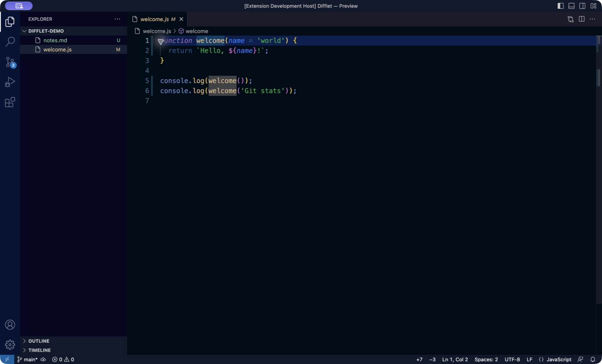

<p align="center">
  
</p>

# Difflet

**Your uncommitted work at a glance.**

Difflet shows **+added −deleted** line counts for the current Git repository in the VS Code status bar. Hover over the counts to see changes for each file, or click either count to open Source Control.



## Features

- **Net saved diff against HEAD.** Counts compare what is saved on disk with your last commit.
- **Untracked files included.** New files count as added lines; you can turn this off.
- **Changes for each file.** The tooltip lists the largest changes, the comparison base, and anything excluded.
- **Multi-repository aware.** Follows the repository of the active editor and labels it when several are open.
- **Fits your theme.** Uses theme colors by default, with optional custom colors and labels.
- **Local and private.** No telemetry and no network access.

## Installation

**VS Code:** search for **Difflet** in the Extensions view, install it from the [Visual Studio Marketplace](https://marketplace.visualstudio.com/items?itemName=Noshpotosh.difflet), or run:

```sh
code --install-extension Noshpotosh.difflet
```

**Cursor, VSCodium, and other Open VSX editors:** install Difflet from [Open VSX](https://open-vsx.org/extension/noshpotosh/difflet) or the editor's Extensions view.

**Manual install:** download a `.vsix` file from [GitHub Releases](https://github.com/noshpotosh/difflet/releases) and run **Extensions: Install from VSIX…**.

### Requirements

- VS Code 1.80 or newer, or a compatible editor.
- Git, with the editor's built-in Git extension enabled.
- A trusted workspace stored on disk. Browser and virtual workspaces and Restricted Mode are not supported.

## What the counts mean

Counts are the **net difference between saved files on disk and HEAD**, plus eligible untracked files. They are not the sum of separate staged and unstaged diffs, so a staged edit that you undo on disk adds nothing. Unsaved editor changes count only after you save. Before the first commit, tracked files are compared with an empty tree.

**Which repository is shown**

- The active editor determines the repository. When the open file isn't in any repository, the counts are hidden.
- When no text editor is active, the last selected repository stays selected while it remains open.
- With several repositories open, a repository label precedes the counts: `frontend · +24 −8`. The label is hidden when only one repository is open.
- Long labels are shortened; hover over the label to see the full repository path.
- Nested repositories and worktrees are found by the built-in Git extension. Totals are never added up across repositories.

**When counts update**

Counts update after saves, file operations, Git state changes, and when the window regains focus. External changes appear when the built-in Git extension refreshes; run **Difflet: Refresh** to update immediately.

**Clean and partial states**

Clean repositories are hidden. A rename or metadata-only change can show `+0 −0`. If a change is excluded from the counts, the indicators stay visible with an explanation, so a partial count isn't mistaken for a clean repository.

## Commands

| Command | Description |
| --- | --- |
| **Difflet: Refresh** | Recalculate the counts now. |
| **Difflet: Show Output** | Open diagnostics for troubleshooting. |

## Limits and exclusions

- Binary files and submodule changes do not contribute line counts. If any are present, the totals are marked as partial.
- Untracked scans process the first 500 paths in deterministic order, at most eight reads concurrently and 2 MiB per file. The tooltip reports skipped files.
- Untracked symlinks, non-regular files, files outside the repository, unreadable files, and files that grow during a read are skipped. Untracked files that contain NUL bytes are treated as binary.
- Ignored untracked files are excluded using Git's ignore rules. Tracked ignored files still count.
- The tooltip lists the 20 largest text-file changes. Ties are sorted by path.
- Each Git command has a 10-second timeout and a 20 MiB output limit. Failure shows **Git stats unavailable**; click for diagnostics, then run **Difflet: Refresh** to retry.

## Settings

Setting keys use the `gitWorkingTreeStats.` prefix. `alignment` and `priority` apply to the whole window and can be set in User or Workspace settings. The other settings can also be set per folder in multi-root workspaces.

| Setting (`gitWorkingTreeStats.` prefix) | Default | Effect |
| --- | --- | --- |
| `alignment` | `"right"` | Status bar side: `"left"` or `"right"`. |
| `priority` | `1000000` | Higher values move the pair farther left within the chosen side. |
| `includeUntracked` | `true` | Include eligible untracked files as added lines. |
| `addedColor` | `""` | Theme foreground; optionally set a hex color. |
| `removedColor` | `""` | Theme foreground; optionally set a hex color. |
| `addedPrefix` | `""` | Label before the addition count. |
| `removedPrefix` | `""` | Label before the deletion count. |

Changes to `alignment` and `priority` apply without reloading. Additions appear before deletions, which use the priority minus one. Other extensions' priorities affect the exact position.

Colors you have set explicitly, including `#FFFFFF`, stay in effect; clear them to follow the theme. Each count has its own accessible label, and you can hide either count from the status bar's context menu.

## Troubleshooting

If the counts are missing or show **Git stats unavailable**:

1. Run **Difflet: Show Output** to see diagnostics.
2. Check that Git is enabled and Source Control can open the repository.
3. Run **Difflet: Refresh**.

Difflet uses the Git executable selected by the built-in Git extension.

## Privacy

Statistics are computed locally, or on the remote host when you use Remote SSH. Difflet has no telemetry and no network access. Diagnostics omit file contents and raw command output.

## Feedback and support

Report bugs and request features on [GitHub Issues](https://github.com/noshpotosh/difflet/issues).

## License

[MIT](https://github.com/noshpotosh/difflet/blob/main/LICENSE)
